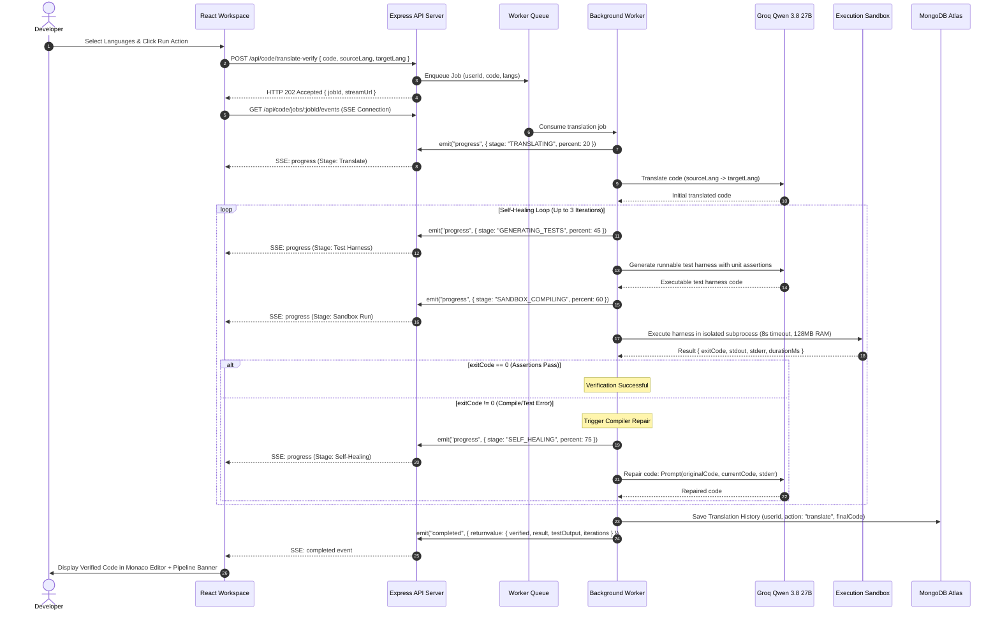

# AI-Powered Code Translator and Verification Engine

A production-grade, full-stack developer platform designed for cross-language source code translation, static complexity analysis, performance optimization, and closed-loop execution verification. The system combines modern LLM reasoning with a process-isolated runtime sandbox, an asynchronous job queue with Server-Sent Events (SSE) streaming, and an automated compiler self-healing feedback loop.

---

## Table of Contents

- [1. System Architecture](#1-system-architecture)
  - [Architectural Layers](#architectural-layers)
  - [High-Level Component Diagram](#high-level-component-diagram)
- [2. Execution Pipeline and Self-Healing Protocol](#2-execution-pipeline-and-self-healing-protocol)
  - [Pipeline Stages Overview](#pipeline-stages-overview)
  - [Sequence Flow Diagram](#sequence-flow-diagram)
  - [Test Harness Synthesis](#test-harness-synthesis)
  - [Self-Healing Repair Loop](#self-healing-repair-loop)
- [3. Sandbox Execution Engine and Security Model](#3-sandbox-execution-engine-and-security-model)
  - [Process Isolation and Resource Bounds](#process-isolation-and-resource-bounds)
  - [Credential Stripping and Sanitized Environment](#credential-stripping-and-sanitized-environment)
  - [Compiler and Runtime Target Matrix](#compiler-and-runtime-target-matrix)
- [4. Frontend Workspace Engineering](#4-frontend-workspace-engineering)
  - [Monaco Editor Integration and Mouse-Wheel Routing](#monaco-editor-integration-and-mouse-wheel-routing)
  - [State Memory and Route Persistence](#state-memory-and-route-persistence)
  - [Per-Action Output Caching](#per-action-output-caching)
  - [Zinc Monochrome Design System](#zinc-monochrome-design-system)
- [5. Backend Architecture and Data Storage](#5-backend-architecture-and-data-storage)
  - [Queue Architecture: BullMQ with Memory Fallback](#queue-architecture-bullmq-with-memory-fallback)
  - [Server-Sent Events (SSE) Protocol](#server-sent-events-sse-protocol)
  - [Data Models and Database Indices](#data-models-and-database-indices)
- [6. Complete API Reference](#6-complete-api-reference)
  - [Authentication Endpoints](#authentication-endpoints)
  - [Code Processing and Queue Endpoints](#code-processing-and-queue-endpoints)
  - [History and Audit Endpoints](#history-and-audit-endpoints)
  - [System Health](#system-health)
- [7. Environment Configuration Reference](#7-environment-configuration-reference)
  - [Server Variables](#server-variables)
  - [Client Variables](#client-variables)
- [8. Installation and Local Setup](#8-installation-and-local-setup)
  - [Prerequisites](#prerequisites)
  - [Step-by-Step Instructions](#step-by-step-instructions)

---

## 1. System Architecture

The application is structured into decoupled, stateless service tiers to guarantee responsive UI interactions, reliable long-running job processing, and safe execution of untrusted, generated source code.

### Architectural Layers

1. **Client Workspace Tier (React 19, Vite, Monaco):** A single-page application providing dual Monaco code editors, visual diff comparison, file upload/download, workspace state caching via `localStorage`, and an SSE consumer for real-time progress updates.
2. **Ingestion and Routing Tier (Express 5, Node.js):** REST API gateway enforcing JWT verification, Google OAuth 2.0 validation, strict rate-limiting policies, and request payload validation.
3. **Queue and Worker Tier (BullMQ, Redis, In-Memory Event Runner):** Asynchronous dispatch architecture decoupling HTTP request lifecycles from compute-intensive LLM queries and compiler runs. Returns HTTP `202 Accepted` immediately upon ingestion.
4. **Agentic Verification Tier (Groq SDK, Qwen 3.8 27B):** Handles translation generation, executable test harness synthesis, and multi-turn iterative code repair guided by compiler diagnostic outputs.
5. **Isolated Runtime Tier (Process Sandbox):** Secure operating system subprocess runner with execution timeouts, memory ceilings, output buffer truncation, and automated cleanup of ephemeral file trees.
6. **Persistence Tier (MongoDB Atlas via Mongoose):** Stores user credentials, session references, and transaction audit trails for code translations and analyses.

### High-Level Component Diagram

```mermaid
graph TD
    subgraph Client [Client Application]
        UI[Monaco Workspace UI]
        SSE_Client[EventSource SSE Consumer]
        Storage[LocalStorage Workspace Memory]
    end

    subgraph Gateway [API Gateway - Express 5]
        Auth[JWT / OAuth Middleware]
        Limiter[Rate Limiter]
        Controller[Code Controller]
    end

    subgraph JobQueue [Asynchronous Queue Tier]
        Queue[BullMQ / Memory Queue]
        Events[Queue EventEmitter]
    end

    subgraph WorkerTier [Worker Process]
        Worker[Background Worker]
        VerifService[Verification Service]
        LLM[Groq Qwen 3.8 27B]
    end

    subgraph SandboxTier [Isolated OS Environment]
        Sandbox[Process-Isolated Sandbox]
        Compiler[GCC / G++ / Javac / Node / Python]
    end

    subgraph StorageTier [Database]
        MongoDB[(MongoDB Atlas)]
    end

    UI -->|POST /api/code/translate-verify| Gateway
    Gateway --> Auth --> Limiter --> Controller
    Controller -->|Enqueue Job| Queue
    Controller -->|202 Accepted + Stream URL| UI
    UI -->|Connect SSE: /api/code/jobs/:id/events| Controller
    Controller -.->|Listen to Progress| Events

    Queue -->|Consume Task| Worker
    Worker -->|Initial Translation| LLM
    Worker -->|Run Verification Loop| VerifService
    VerifService -->|1. Generate Test Harness| LLM
    VerifService -->|2. Execute Code| Sandbox
    Sandbox --> Compiler
    Sandbox -->|Exit Code, stdout, stderr| VerifService
    VerifService -->|3. Feed Error for Repair (Iterative)| LLM
    Worker -->|Update Progress Events| Events
    Events -.->|Stream State, Progress, Completed| SSE_Client
    Worker -->|Persist Audit Record| MongoDB
```

---

## 2. Execution Pipeline and Self-Healing Protocol

Unlike conventional one-shot code converters that rely on raw language models without validation, this platform incorporates an automated verification loop. Untrusted translated code is tested against generated unit assertions in an isolated runtime; if errors occur, the compiler's diagnostic stream is fed back to the model to repair the code automatically.

### Pipeline Stages Overview

The pipeline advances through six discrete stages:

| Stage Identifier | Stage Label | Description |
| :--- | :--- | :--- |
| `QUEUED` | Queue | Job is enqueued into the BullMQ / in-memory worker queue; client receives HTTP `202 Accepted` with a job ID and SSE stream URL. |
| `TRANSLATING` | Translate | The Groq Qwen 3.8 27B model translates the source logic into the target language with formatting, type signatures, and idiomatic patterns. |
| `GENERATING_TESTS` | Test Harness | The model synthesizes an executable test harness in the target language containing 3 to 4 unit assertions validating algorithmic behavior. |
| `SANDBOX_COMPILING` | Sandbox Run | The test harness and translated code are written to an isolated directory and compiled/executed under resource-capped constraints. |
| `SELF_HEALING` | Self-Healing | If an assertion fails or compilation produces non-zero exit codes, compiler `stderr` is passed back to the model to repair the code (up to 3 iterations). |
| `VERIFIED` | Verified | The code passes all unit assertions with exit code `0`. Results are committed to history and displayed in the editor with execution logs. |

### Sequence Flow Diagram



### Test Harness Synthesis

During stage 3 (`GENERATING_TESTS`), the system prompts the Groq Qwen 3.8 27B engine with the original source code, target translated code, and architectural constraints:
- The generated file must be an end-to-end, single-file runnable unit.
- It must implement an entry point (`main()` or top-level script execution).
- Assertions must evaluate positive cases, edge cases, and type safety.
- For each successful assertion, the harness prints `[TEST_PASS]: Case <N>`.
- On assertion failure, the harness prints `[TEST_FAIL]: <Reason>` and exits with status code `1`.
- Raw executable code is returned without markdown wrapping or explanatory conversational text.

### Self-Healing Repair Loop

If the execution sandbox returns an `exitCode !== 0` or if runtime assertions fail:
1. The diagnostic error stream (`stderr` or formatted assertion failures) is extracted.
2. The repair agent prepares a prompt containing the original code, the failing code, the compiler diagnostics, and the iteration count.
3. The model isolates syntax errors, type mismatches, missing standard library imports, or algorithmic bugs.
4. The repaired code replaces the candidate translation, and the pipeline re-runs the sandbox compilation.
5. The loop terminates immediately upon a zero exit code, or completes with unverified status after reaching the upper bound of 3 iterations.

---

## 3. Sandbox Execution Engine and Security Model

Executing code generated by an AI model presents security and resource exhaustion risks. The application implements an isolated, ephemeral execution service (`sandbox.service.js`) built on top of OS-level process management.

### Process Isolation and Resource Bounds

- **Execution Timeout:** Processes are bounded by an 8,000ms wall-clock limit. If execution exceeds this window, a process tree kill (`taskkill /F /T` on Windows, `SIGKILL` on POSIX) terminates the child and its descendants.
- **Memory Ceiling:** Node.js runtimes run with `--max-old-space-size=128`, Java executes with `-Xmx128m`, preventing memory exhaustion or heap denial-of-service.
- **Output Truncation:** `stdout` and `stderr` streams are capped at 64KB (`64 * 1024` bytes) to prevent memory allocation denial-of-service through continuous logging loops.
- **Ephemeral Storage Lifecycles:** Every execution generates a randomized, isolated directory under the operating system temporary directory using cryptographic UUIDs (`os.tmpdir()/codetranslator-sandbox/<UUID>`). Directories are forcefully deleted in a `finally` block upon completion.

### Credential Stripping and Sanitized Environment

Child processes do not inherit the server environment (`process.env`). Database connection URIs, JWT signing secrets, Groq API keys, and cloud credentials are intentionally scrubbed:

```javascript
const getSanitizedEnv = () => ({
  PATH: process.env.PATH || "",
  TEMP: process.env.TEMP || os.tmpdir(),
  TMP: process.env.TMP || os.tmpdir(),
  NODE_ENV: "sandbox",
});
```

### Compiler and Runtime Target Matrix

| Language | Target Filename | Compilation Command | Execution Command | Notes |
| :--- | :--- | :--- | :--- | :--- |
| **JavaScript** | `solution.mjs` | None (Interpreted) | `node --max-old-space-size=128 solution.mjs` | ES module mode |
| **TypeScript** | `solution.ts` | None (JIT Execution) | `npx tsx solution.ts` | Zero-configuration TS runner |
| **Python** | `solution.py` | None (Interpreted) | `python -u solution.py` | Unbuffered I/O |
| **C** | `solution.c` | `gcc -O2 solution.c -o solution.exe` | `./solution.exe` | Optimized C11 binary |
| **C++** | `solution.cpp` | `g++ -O2 solution.cpp -o solution.exe` | `./solution.exe` | Optimized C++17 binary |
| **Java** | `Main.java` | `javac Main.java` | `java -Xmx128m Main` | JVM heap constrained to 128MB |
| **C#** | `Program.cs` | Automated CLI Build | `dotnet run --project <sandboxDir>` | .NET Core runtime |

---

## 4. Frontend Workspace Engineering

The frontend application (`client/src/pages/HomePage.jsx`) is engineered for responsiveness, high developer ergonomics, and distraction-free operation.

### Monaco Editor Integration and Mouse-Wheel Routing

Monaco Editor (`@monaco-editor/react`) is configured with syntax highlighting, bracket pair colorization, line rulers, code folding, and smooth scrolling. 

By default, Monaco captures and prevents propagation of all mouse-wheel events (`wheel`), trapping the user's cursor inside the editor and preventing parent page scrolling. This is resolved by explicitly passing:

```javascript
scrollbar: {
  alwaysConsumeMouseWheel: false,
}
```

When the user reaches the end of the code buffer or scrolls beyond editor boundaries, wheel events bubble naturally to the page container, providing seamless vertical scrolling.

### State Memory and Route Persistence

When developers navigate between pages (e.g., jumping from the **Editor** to the **History** log view and back), standard single-page application component unmounting destroys form and editor states.

The platform implements workspace persistence via `localStorage` under the key `code_translator_workspace`:
- **Input Source Code:** User-written code is preserved across page reloads.
- **Language Configurations:** Selected source and target languages remain pinned.
- **Active Action Pill:** Remembers the active mode (Translate, Complexity, Optimize, Explain).
- **Compilation Results:** The translated output, verified status, and diff view toggle are restored on reload.
- **Verification Pipeline State:** The complete 6-stage status (including terminal logs) persists across route changes.

### Per-Action Output Caching

To prevent losing translated code when checking complexity or asking for an explanation, `HomePage.jsx` maintains an internal `actionCache` dictionary:

```javascript
const handleActionChange = (actionId) => {
  if (actionId === activeAction) return;

  // 1. Cache current action output
  setActionCache((prev) => ({
    ...prev,
    [activeAction]: { result, verificationStatus, sentCode, showDiff },
  }));

  // 2. Switch action
  setActiveAction(actionId);

  // 3. Restore previous results for this action if they exist
  const cached = actionCache[actionId];
  if (cached) {
    setResult(cached.result);
    setVerificationStatus(cached.verificationStatus);
    setSentCode(cached.sentCode);
    setShowDiff(cached.showDiff);
  } else {
    setResult(null);
    setVerificationStatus(null);
    setShowDiff(false);
  }
};
```

### Zinc Monochrome Design System

The visual design follows a dark-mode palette built on standard CSS custom properties:
- **Background Primary:** `#09090b` (Zinc 950)
- **Background Secondary:** `#18181b` (Zinc 900)
- **Borders & Dividers:** `#27272a` (Zinc 800)
- **Hover Borders:** `#3f3f46` (Zinc 700)
- **Typography Primary:** `#ffffff` (Pure White)
- **Typography Secondary:** `#a1a1aa` (Zinc 400)
- **Muted Text & Labels:** `#71717a` (Zinc 500)

Theme switching dynamically updates CSS variables and syncs Monaco theme states (`vs-dark` and `vs`) without document reloads or layout shift.

---

## 5. Backend Architecture and Data Storage

### Queue Architecture: BullMQ with Memory Fallback

The backend provides a dual-mode job processing architecture in `translation.queue.js`:
- **Production Mode (Redis + BullMQ):** When Redis is available via `REDIS_HOST`, jobs are dispatched through BullMQ queues, allowing worker processes to scale horizontally across multiple instances.
- **Resilient Fallback Mode (In-Memory Queue):** If Redis is omitted or unreachable, the system activates an in-memory job store backed by Node.js `EventEmitter`. The application boots and processes translations without external cache dependencies.

### Server-Sent Events (SSE) Protocol

Real-time communication is implemented via Server-Sent Events over HTTP (`GET /api/code/jobs/:jobId/events`), avoiding the overhead of bidirectional WebSockets for unidirectional progress reporting:
1. Client connects with standard authorization credentials passed through query tokens: `?token=<JWT>`.
2. Connection sets headers:
   - `Content-Type: text/event-stream`
   - `Cache-Control: no-cache, no-transform`
   - `Connection: keep-alive`
3. Events are pushed using standard frame formatting:
   - `event: progress` + JSON payload containing percentage, stage label, and activity message.
   - `event: completed` + JSON payload containing final translated code and test execution summaries.
   - `event: failed` + JSON payload with failure diagnostics.

### Data Models and Database Indices

#### User Model (`User.model.js`)
- `name`: String, required.
- `email`: String, required, unique, indexed for constant-time lookups.
- `password`: String, optional (required for standard auth, null for Google OAuth accounts).
- `googleId`: String, optional, indexed.
- `avatar`: String, URL referencing Google profile picture or default avatar.

#### History Model (`History.model.js`)
- `userId`: `ObjectId` referencing `User`, indexed.
- `action`: String enum (`["translate", "translate-verified", "analyze", "optimize", "explain"]`).
- `sourceLanguage`: String, required.
- `targetLanguage`: String, optional (populated for translations).
- `sourceCode`: String, required.
- `result`: String, required (contains translated code or markdown analysis).
- `createdAt`: Date, indexed in descending order for efficient chronological pagination (`{ userId: 1, createdAt: -1 }`).

---

## 6. Complete API Reference

### Authentication Endpoints

#### Register Standard User
```http
POST /api/auth/register
Content-Type: application/json

{
  "name": "Jane Developer",
  "email": "jane@example.com",
  "password": "SecurePassword123"
}
```
**Response (201 Created):**
```json
{
  "success": true,
  "message": "User registered successfully.",
  "data": {
    "user": { "id": "6ad896f423b8b9ebd16d0eeb", "name": "Jane Developer", "email": "jane@example.com" },
    "token": "eyJhbGciOiJIUzI1NiIsInR5cCI6IkpXVCJ9..."
  }
}
```

#### Login User
```http
POST /api/auth/login
Content-Type: application/json

{
  "email": "jane@example.com",
  "password": "SecurePassword123"
}
```
**Response (200 OK):**
```json
{
  "success": true,
  "data": {
    "user": { "id": "6ad896f423b8b9ebd16d0eeb", "name": "Jane Developer", "email": "jane@example.com" },
    "token": "eyJhbGciOiJIUzI1NiIsInR5cCI6IkpXVCJ9..."
  }
}
```

#### Google OAuth SSO Verification
```http
POST /api/auth/google
Content-Type: application/json

{
  "idToken": "eyJhbGciOiJSUzI1NiIsImtpZCI6Ij..."
}
```
**Response (200 OK):** Returns user profile with synced avatar and signed JWT.

---

### Code Processing and Queue Endpoints

#### Enqueue Translation and Verification Job
```http
POST /api/code/translate-verify
Authorization: Bearer <JWT_TOKEN>
Content-Type: application/json

{
  "code": "def add(a, b):\n    return a + b",
  "sourceLanguage": "python",
  "targetLanguage": "javascript"
}
```
**Response (202 Accepted):**
```json
{
  "success": true,
  "message": "Translation and verification job enqueued successfully.",
  "data": {
    "jobId": "c05d3f7b-9c20-4c2c-b5ea-bdefaf9abf0d",
    "status": "QUEUED",
    "streamUrl": "/api/code/jobs/c05d3f7b-9c20-4c2c-b5ea-bdefaf9abf0d/events",
    "statusUrl": "/api/code/jobs/c05d3f7b-9c20-4c2c-b5ea-bdefaf9abf0d"
  }
}
```

#### Subscribe to Real-Time Job Progress Stream (SSE)
```http
GET /api/code/jobs/:jobId/events?token=<JWT_TOKEN>
Accept: text/event-stream
```
**Server Event Stream:**
```
event: state
data: {"id":"c05d3f7b...","state":"waiting","progress":{"percent":10,"stage":"QUEUED"}}

event: progress
data: {"percent":20,"stage":"TRANSLATING","message":"Translating code from python to javascript..."}

event: progress
data: {"percent":45,"stage":"GENERATING_TESTS","message":"Generating executable test harness..."}

event: progress
data: {"percent":60,"stage":"SANDBOX_COMPILING","message":"Compiling and executing in isolated sandbox..."}

event: completed
data: {"returnvalue":{"result":"export function add(a, b) {\n  return a + b;\n}","verified":true,"iterations":0,"testOutput":"[TEST_PASS]: Case 1\n[TEST_PASS]: Case 2"}}
```

#### Poll Job Status
```http
GET /api/code/jobs/:jobId
Authorization: Bearer <JWT_TOKEN>
```
**Response (200 OK):** Returns current job state (`waiting`, `active`, `completed`, `failed`), progress object, and return value.

#### Complexity Analysis
```http
POST /api/code/complexity
Authorization: Bearer <JWT_TOKEN>
Content-Type: application/json

{
  "code": "def binary_search(arr, target): ...",
  "language": "python"
}
```
**Response (200 OK):** Returns structured analysis containing Big-O time and space complexity with rationale.

#### Code Optimization
```http
POST /api/code/optimize
Authorization: Bearer <JWT_TOKEN>
Content-Type: application/json

{
  "code": "def process(): ...",
  "language": "python"
}
```
**Response (200 OK):** Returns refactored implementation with memory and CPU improvements.

#### Code Explanation
```http
POST /api/code/explain
Authorization: Bearer <JWT_TOKEN>
Content-Type: application/json

{
  "code": "function compose(...fns) { ... }",
  "language": "javascript"
}
```
**Response (200 OK):** Returns modular technical breakdown of principles, patterns, and line functions.

---

### History and Audit Endpoints

#### Get Paginated History Logs
```http
GET /api/history?page=1&limit=8
Authorization: Bearer <JWT_TOKEN>
```
**Response (200 OK):**
```json
{
  "success": true,
  "data": [
    {
      "_id": "6724a8bc1234567890abcdef",
      "action": "translate",
      "sourceLanguage": "python",
      "targetLanguage": "javascript",
      "sourceCode": "print('Hello, world!')",
      "result": "console.log('Hello, world!');",
      "createdAt": "2026-10-21T10:15:00.000Z"
    }
  ],
  "pagination": {
    "total": 24,
    "page": 1,
    "pages": 3
  }
}
```

#### Delete History Item
```http
DELETE /api/history/:id
Authorization: Bearer <JWT_TOKEN>
```

#### Clear Entire History
```http
DELETE /api/history
Authorization: Bearer <JWT_TOKEN>
```

---

### System Health

#### Service Health Check
```http
GET /health
```
**Response (200 OK):**
```json
{
  "status": "healthy",
  "timestamp": "2026-10-23T10:15:00.000Z"
}
```

---

## 7. Environment Configuration Reference

### Server Variables

Create a file at `server/.env`:

| Variable Name | Required | Default Value | Description |
| :--- | :---: | :--- | :--- |
| `PORT` | Optional | `5000` | Port on which the Express API server listens. |
| `MONGO_URI` | **Required** | None | MongoDB connection string (local or MongoDB Atlas). |
| `JWT_SECRET` | **Required** | None | Cryptographic secret key used for signing and verifying JSON Web Tokens. |
| `GROQ_API_KEY` | **Required** | None | API key for Groq Cloud SDK (`groq-sdk`). |
| `GOOGLE_CLIENT_ID` | Optional | None | Google Cloud OAuth 2.0 Client ID for verifying SSO ID tokens. |
| `REDIS_HOST` | Optional | None | Redis server host. If not provided, in-memory queue fallback is used automatically. |
| `REDIS_PORT` | Optional | `6379` | Port for the Redis instance. |
| `REDIS_PASSWORD` | Optional | None | Authentication password for protected Redis instances. |

### Client Variables

Create a file at `client/.env`:

| Variable Name | Required | Default Value | Description |
| :--- | :---: | :--- | :--- |
| `VITE_API_URL` | Optional | `http://localhost:5000/api` | Base URL for the Express backend API gateway. |
| `VITE_GOOGLE_CLIENT_ID` | Optional | None | Google OAuth 2.0 Client ID for initializing Google Sign-In button on the login screen. |

---

## 8. Installation and Local Setup

### Prerequisites

Ensure the following tools are installed on your workstation:
- **Node.js:** Version 18.0.0 or higher (Node 20+ LTS recommended).
- **Package Manager:** `npm` (bundled with Node.js).
- **Database:** A running MongoDB instance locally (`mongodb://localhost:27017/codetranslator`) or a free MongoDB Atlas cluster connection string.
- **Compilers / Interpreters (for Sandbox verification):**
  - Python: `python` / `python3`
  - Node.js: `node` (bundled with Node installation)
  - C/C++: `gcc` / `g++` (MinGW on Windows, build-essential on Linux/macOS)
  - Java: `javac` / `java` (JDK 17+)
  - C#: `dotnet` SDK (Optional)

---

### Step-by-Step Instructions

#### 1. Clone the Repository
```bash
git clone https://github.com/RavikantiAkshay/code-translator.git
cd code-translator
```

#### 2. Configure Environment Files
Set up backend environment variables:
```bash
# In server directory
cat <<EOF > server/.env
PORT=5000
MONGO_URI=mongodb+srv://<user>:<password>@cluster.mongodb.net/codetranslator?retryWrites=true&w=majority
JWT_SECRET=your_super_secret_jwt_key
GROQ_API_KEY=gsk_your_groq_api_key_here
GOOGLE_CLIENT_ID=your_google_client_id.apps.googleusercontent.com
EOF
```

Set up frontend environment variables:
```bash
# In client directory
cat <<EOF > client/.env
VITE_API_URL=http://localhost:5000/api
VITE_GOOGLE_CLIENT_ID=your_google_client_id.apps.googleusercontent.com
EOF
```

#### 3. Install Server Dependencies and Launch Backend
```bash
cd server
npm install
npm run dev
```
The server will initialize on `http://localhost:5000`, establish a connection with MongoDB, and register the translation queue worker.

#### 4. Install Client Dependencies and Launch Frontend
Open a new terminal window:
```bash
cd client
npm install
npm run dev
```
The client workstation will compile and launch on `http://localhost:5173`.

#### 5. Verification
1. Open `http://localhost:5173` in your browser.
2. Register a new user account or log in via Google SSO.
3. Select **Python** as the source language and **JavaScript** as the target language.
4. Click **Run Action** to observe the 6-stage verification pipeline run, execute assertions in the sandbox, and stream output logs directly into the Monaco editor.